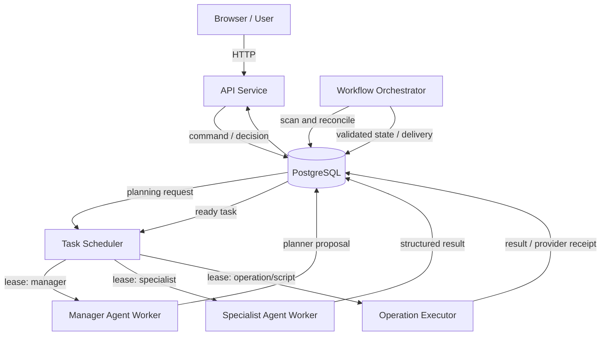
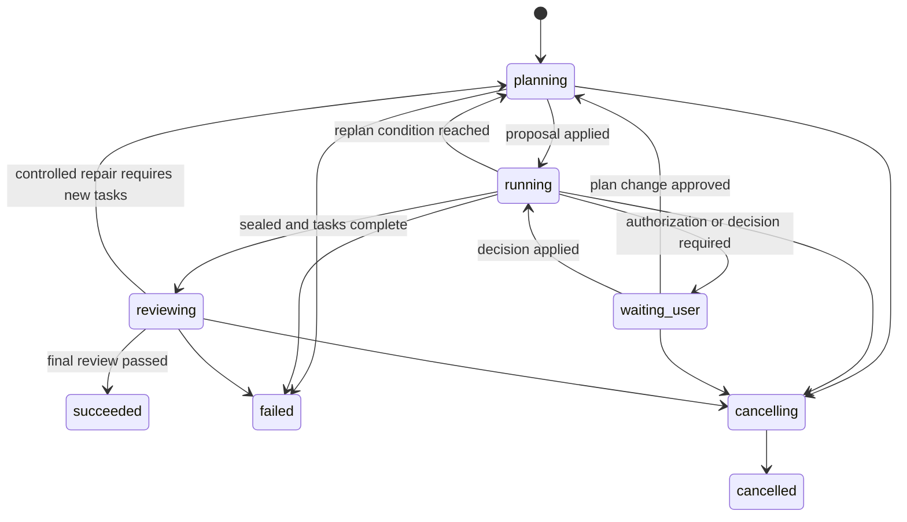

# Video-use 动态多 Agent Workflow 改造设计

> 状态：设计草案  
> 日期：2026-11-02  
> 适用范围：`/data2/wujing03/video-use` 现有系统的架构改造  
> 前提：项目尚未正式发布；复用现有成熟实现，但不要求兼容现有 Workflow 数据、状态或 API

## 1. 背景

当前系统已经具备以下基础能力：

- Agent 讨论、规划、执行、验收和诊断；
- 持久化 Workflow、步骤依赖和步骤 revision；
- PostgreSQL 任务状态、执行租约和资源协调；
- 本地脚本、固定 operation、外部异步供应商调用；
- 暂停、继续、取消、恢复、质量验收和最终交付；
- API、AgentHost、执行节点及对象存储的分布式运行。

当前 Workflow 的基本模式是：Agent 在执行开始时一次性提交完整计划，系统校验后形成相对固定的 DAG，Runner 按依赖推进。计划一旦提交，不能被另一份计划替换。

目标是改造成滚动规划模式：Manager Agent 只规划当前信息足以确定的任务，执行结果返回后再次规划，逐步扩展 DAG；专业 Agent、确定性 operation 和脚本可以共同成为 DAG 节点。

## 2. 目标与非目标

### 2.1 目标

1. 支持 Manager Agent 根据执行结果动态追加任务和依赖。
2. 支持 `operation`、`script`、`agent` 三类任务节点。
3. 使用持久化、版本化 DAG 保证重启和跨节点恢复。
4. 独立部署 Workflow Orchestrator，通过扫描 PostgreSQL 推进状态机。
5. Scheduler 只负责资源选择、并发控制和执行租约。
6. Manager 只有提案权，Orchestrator 拥有正式状态提交权。
7. 所有外部副作用、用户审批、产物发布和迟到结果均受确定性协议保护。
8. 未封口的 Workflow 不得提前验收或交付。

### 2.2 非目标

- 不构建 Agent 之间自由聊天的群聊系统。
- 不允许 Manager 动态提交任意系统 Prompt、Skill、Tool 或权限。
- 不让 Orchestrator 执行 FFmpeg、模型推理或媒体处理。
- 第一阶段不支持修改已开始或已完成任务。
- 第一阶段不支持任意删除节点或重写既有 DAG。
- 不依赖消息队列或数据库通知保证正确性。

### 2.3 复用与兼容边界

本次改造区分“复用”和“兼容”：

- **复用**：继续使用已经验证的代码、运行时和基础设施能力，减少重复建设。
- **不兼容**：不为旧 Workflow 数据、旧状态、旧接口和旧执行中任务增加迁移或双写逻辑。

优先复用：

- PostgreSQL `Store`、事务封装和项目归属校验；
- execution lease、generation、续租、过期接管和资源限制；
- Scheduler 的公平排序、CPU/内存/GPU/供应商并发判断；
- operation 注册表、参数模型、生命周期实现和供应商调用协议；
- script/operation 的隔离沙盒、运行时、reaper 和清理机制；
- 对象存储、不可变产物、检查点、哈希和发布机制；
- AgentHost、Agent Gateway、权限 Profile 和受限工具入口；
- 技术验收、Agent Review、用户决策和质量证据规则；
- SSE、活动流、用量账本、日志、指标和诊断链路；
- systemd 集群部署、draining、健康检查和冻结发布流程。

直接重构或替换：

- 一次性完整 `Plan` 和不可变 `definition` 的工作流模型；
- 旧 `agent_workflows` / `agent_steps` 状态语义；
- `submit` 后禁止扩图的接口契约；
- 依赖旧状态的 Runner 推进逻辑；
- 旧 Workflow API 响应结构和页面展示逻辑；
- 开发环境中的旧 Workflow 测试数据。

实现时不要求新旧逻辑并行运行，也不要求读取旧任务。旧表可以在开发环境明确清理后由新结构替换，但清理动作仍需单独确认和执行。

## 3. 核心原则

### 3.1 职责分离

| 组件 | 核心问题 | 职责 |
| --- | --- | --- |
| Manager Agent | 接下来应该做什么 | 规划、拆分、委派、重新规划、封口 |
| Workflow Orchestrator | 当前状态允许发生什么 | 校验提案、推进状态机、解锁任务、重试、审批和交付 |
| Scheduler | 谁在何处执行 | 公平调度、资源匹配、并发限制和 lease |
| Executor | 如何完成一个任务 | 运行脚本、operation 或专业 Agent |
| Reviewer Agent | 结果是否符合目标 | 基于冻结快照提交结构化验收结论 |
| API Service | 用户希望系统做什么 | 鉴权、接收命令和决策、查询公开状态 |

原则：LLM 可以提出状态变化，但不能直接提交正式状态。

### 3.2 数据库是事实来源

所有业务交接以 PostgreSQL 中的持久化状态为准。HTTP、进程内事件或可选唤醒只能降低延迟，不能成为正确性依赖。

### 3.3 动态 DAG 采用追加模型

第一阶段只允许：

- 追加新任务；
- 追加新任务之间的依赖；
- 新任务依赖已经存在的任务；
- 更新 Workflow 的 `replan_after` 和 `sealed`。

不允许：

- 修改已存在任务的业务契约；
- 让旧任务新增对未来任务的依赖；
- 删除已有任务；
- 将已成功任务退回未执行状态；
- 使用重新规划绕过用户授权。

## 4. 总体架构



核心控制流：

```text
用户目标
  -> Manager 提交第一批 DAG Proposal
  -> Orchestrator 校验并应用
  -> Scheduler 分配 ready task
  -> Executor/专业 Agent 返回结果
  -> Orchestrator 提交结果并推进状态
  -> 满足 replan_after 时再次启动 Manager
  -> Manager 追加 DAG 或 sealed=true
  -> 所有任务完成后进入最终验收
  -> Orchestrator 发布交付物
```

## 5. 组件设计

### 5.1 Manager Agent

Manager 是受限的规划 Agent，只能读取：

- 用户确认的目标和授权包络；
- 当前 DAG 和 graph version；
- 已完成任务的结构化结果及允许引用的产物；
- 失败诊断、剩余预算和可用 Agent Profile/operation；
- 当前阻塞项和用户决策。

Manager 只能输出结构化 Proposal：

```json
{
  "proposal_id": "8db2...",
  "base_graph_version": 3,
  "reason": "完成素材分析后，需要生成两个可比较的剪辑候选",
  "add_tasks": [],
  "add_dependencies": [],
  "replan_after": ["compare_candidates"],
  "sealed": false
}
```

Manager 不得：

- 直接更新 Workflow/Task 状态；
- 直接调用收费供应商；
- 自行扩大素材、operation、调用次数或交付目标；
- 直接发布产物；
- 修改已存在节点。

### 5.2 Workflow Orchestrator

Orchestrator 是独立部署的确定性服务，不是 LLM，也不是业务 Executor。

职责：

1. 扫描到期 Workflow。
2. 领取 Workflow reconcile lease。
3. 读取命令、Proposal、Task result 和用户决策。
4. 校验并应用 DAG Proposal。
5. 计算被依赖阻塞和可以执行的 Task。
6. 创建 Manager、Reviewer 和用户决策请求。
7. 管理 Task 重试、暂停、取消和超时。
8. 验证 lease、revision、graph version 和迟到结果。
9. 处理最终验收和产物发布。
10. 计算下一次 `next_reconcile_at`。

Orchestrator 不提供业务 API。可选监听仅内部可见的运维端口：

```text
GET /healthz
GET /readyz
GET /metrics
POST /internal/wakeup   # 可选，只缩短等待，不传递业务状态
```

### 5.3 Scheduler

Scheduler 只扫描 `ready` Task，并负责：

- 用户、项目和节点公平性；
- CPU、内存、GPU 和供应商并发匹配；
- Worker 选择；
- 创建、续租和回收 execution lease；
- 节点 draining 和不可用处理。

Scheduler 不判断业务目标是否完成，不创建新 DAG 节点，不决定产物是否通过验收。

### 5.4 Executor

Executor 接收一个已领取 Task：

- `script`：在隔离沙盒执行受控命令；
- `operation`：执行服务端登记的确定性能力；
- `agent`：按服务端 Agent Profile 启动专业 Agent Loop。

Executor 只写入候选结果或调用回执，不直接把正式 Task 状态改为 `succeeded`。Orchestrator 验证后提交最终状态。

### 5.5 Agent Profile

专业 Agent 不接受 Manager 提交的任意 Prompt/权限，而是引用服务端登记的 Profile：

```text
profile_id
name
purpose
prompt_template
skills
tool_allowlist
permission_profile
model_policy
token_budget
max_turns
input_schema
output_schema
artifact_policy
```

示例 Profile：

- `media_planner`
- `visual_quality_reviewer`
- `media_failure_diagnostician`
- `editing_implementer`
- `delivery_reviewer`

## 6. 动态 DAG 协议

### 6.1 Task 模型

```json
{
  "id": "diagnose_generation",
  "type": "agent",
  "name": "分析视频生成失败原因",
  "profile": "media_failure_diagnostician",
  "objective": "根据日志、调用回执和候选产物给出结构化根因",
  "inputs": {
    "provider_receipt": {"task": "generate_video", "role": "receipt"}
  },
  "output_roles": {
    "diagnosis": "diagnosis.json"
  },
  "acceptance": [],
  "timeout_seconds": 900,
  "retry_policy": "safe_once",
  "on_failure": "pause"
}
```

### 6.2 Proposal 校验

Orchestrator 应在单个数据库事务中校验并提交：

1. Workflow 仍处于允许扩图的状态。
2. `base_graph_version` 等于当前版本。
3. `proposal_id` 未应用；重复请求返回原结果。
4. 新 Task ID 在整个 Workflow 唯一。
5. 依赖存在且追加后图无环。
6. Task 类型、Profile、operation 和参数有效。
7. 输入只引用当前项目素材或已声明上游输出。
8. 新任务不超出用户确认的授权包络。
9. 外部调用累计次数、成本和资源预算不超限。
10. Workflow 未取消、未终止、未进入最终发布。

提交成功后：

- 写入 Task 和依赖；
- `graph_version += 1`；
- 更新 `replan_after`、`sealed`；
- Proposal 标记为 `applied`；
- `next_reconcile_at = now()`。

### 6.3 封口

`sealed=true` 表示 Manager 确认不再需要扩图，但不表示任务成功。

只有同时满足以下条件，才能进入最终验收：

- `sealed=true`；
- 所有必要 Task 已成功；
- 没有活动 Planning Request；
- 没有活动 execution lease；
- 没有待处理用户决策；
- 没有未确认的外部调用；
- 所有交付候选均已完成技术验收。

## 7. 数据模型

### 7.1 workflow_runs

```text
id
project_id
goal
status
graph_version
sealed
authorization_json
replan_after_json
next_reconcile_at
reconcile_owner
reconcile_until
created_at
updated_at
terminal_reason
```

### 7.2 workflow_tasks

```text
id
workflow_id
type                 # script / operation / agent
spec_json
status
created_graph_version
revision
attempts
next_run_at
wait_reason
candidate_result_json
accepted_result_json
error_code
error_detail
created_at
updated_at
```

唯一键：`(workflow_id, id)`。

### 7.3 workflow_dependencies

```text
workflow_id
upstream_task_id
downstream_task_id
created_graph_version
```

唯一键：`(workflow_id, upstream_task_id, downstream_task_id)`。

### 7.4 planner_runs

```text
id
workflow_id
base_graph_version
trigger_json
snapshot_json
snapshot_digest
status               # pending / running / staged / applied / rejected / exhausted
proposal_json
attempts
created_at
updated_at
```

### 7.5 agent_profiles

服务端代码登记或数据库登记均可，初期建议代码登记，避免运行时随意修改权限。

### 7.6 workflow_commands

```text
id
workflow_id
actor
action               # cancel / pause / resume
payload_json
status               # pending / applied / rejected
created_at
applied_at
```

### 7.7 task_results

```text
id
workflow_id
task_id
task_revision
lease_id
lease_generation
outcome
result_json
artifact_manifest
created_at
committed_at
```

同一个 `(task_id, revision, lease_generation)` 只能提交一次有效结果。

## 8. 状态机

### 8.1 Workflow 状态



### 8.2 Task 状态

```text
blocked
  -> ready
  -> leased
  -> running
  -> waiting          # 等待外部供应商，不占计算槽
  -> collecting
  -> validating
  -> reviewing
  -> succeeded

任意活动状态可按协议进入 retry_wait / paused / cancelling / failed / cancelled。
```

状态与等待原因分开，避免把资源不足、依赖未完成、等待用户和等待供应商都表达为同一个状态。

## 9. Orchestrator 扫描设计

### 9.1 到期扫描

推荐初始参数：

- 扫描间隔：1 秒；
- 每批最多 100 个 Workflow；
- reconcile lease：15 秒；
- 单次 reconcile 应保持短小，不执行媒体处理或模型调用。

查询示意：

```sql
SELECT id
FROM workflow_runs
WHERE status NOT IN ('succeeded', 'failed', 'cancelled')
  AND next_reconcile_at <= now()
  AND (reconcile_until IS NULL OR reconcile_until < now())
ORDER BY next_reconcile_at, id
LIMIT 100
FOR UPDATE SKIP LOCKED;
```

领取后设置 `reconcile_owner` 和 `reconcile_until`，在事务外计算，再以 `graph_version` 和当前状态作为条件提交。

### 9.2 reconcile 顺序

```text
1. 核对 Workflow lease 和终止状态
2. 应用用户 command
3. 接收并验证 Task result
4. 处理超时、失败、取消和迟到结果
5. 应用 Manager Proposal
6. 更新依赖满足的 blocked Task 为 ready
7. 判断是否需要 Manager 重新规划
8. 判断是否需要用户决策
9. 判断是否可以进入最终验收
10. 计算 next_reconcile_at 并释放 reconcile lease
```

### 9.3 幂等要求

重复执行 `reconcile()` 必须满足：

- 不重复创建 Planner Run；
- 不重复应用 Proposal；
- 不重复提交 Task Result；
- 不重复发布产物；
- 不重复发起外部调用；
- 不因重复扫描增加重试计数；
- 不允许旧 graph version 覆盖新状态。

## 10. 数据库交互边界

| 表/对象 | 主要写入者 |
| --- | --- |
| `workflow_commands` | API Service |
| `planner_runs.proposal` | Manager Agent Worker |
| `task_results` | Executor / Specialist Agent Worker |
| `workflow_runs` | Orchestrator |
| `workflow_tasks` 正式状态 | Orchestrator |
| `workflow_dependencies` | Orchestrator 应用 Proposal 时写入 |
| `execution_leases` | Scheduler |
| 用户决策 | API Service |
| 正式交付状态 | Orchestrator |

API、Manager 和 Executor 不应直接修改 Workflow 主状态。

## 11. 用户授权包络

用户确认的不是一份永远不变的完整 DAG，而是一个可执行范围：

```text
goal
allowed_assets
allowed_operations
allowed_agent_profiles
provider_call_budget
cost_budget
model_token_budget
wall_time_budget
delivery_targets
content_fingerprint
```

动态新增节点在包络内可以自动执行。以下情况必须暂停并创建 `plan_change`：

- 新增未授权 operation 或 Agent Profile；
- 增加收费调用次数或预算；
- 更换输入素材或目标画布；
- 改变最终交付目标；
- 扩大数据访问范围；
- 降低验收标准；
- 对提交结果未知的外部调用发起替代请求。

## 12. 失败、重试与恢复

### 12.1 Manager 失败

- Planner Run 可在预算内重新领取；
- 相同 `base_graph_version` 和快照恢复；
- 已 staged 但未 applied 的 Proposal 可以重新校验；
- graph version 已变化则废弃旧 Proposal 并重新规划。

### 12.2 Task 失败

- 确定性且声明 retry-safe 的任务按策略重试；
- 外部提交未知时暂停核实，不自动重提；
- 内容或策略问题可触发诊断 Agent；
- 需要新增任务时返回 Manager 重新规划；
- 需要扩大授权时进入 `waiting_user`。

### 12.3 Orchestrator 失败

Orchestrator 不持有不可恢复的内存状态。实例退出后，`reconcile_until` 过期，其他实例或重启实例继续扫描。

### 12.4 Scheduler/Executor 失败

- execution lease 过期后重新调度；
- Task result 必须绑定 revision 和 lease generation；
- 旧执行者迟到结果只记录为证据或待清理对象，不改变正式业务状态。

## 13. 审批、验收与交付

1. Executor 返回候选结果。
2. Orchestrator 进行结构、文件、哈希、类型等技术验收。
3. 需要内容判断时创建 Reviewer Agent Task。
4. Reviewer 基于冻结快照提交结构化证据和结论。
5. 不合格结果进入受控修复、重新规划或用户决策。
6. Workflow sealed 且全部必要任务通过后创建 Final Review。
7. Orchestrator 验证最终交付清单并执行一次性发布。

候选产物、已验收产物和正式交付产物必须保持不同状态。

## 14. 独立部署

新增服务：

```text
video-use-orchestrator.service
```

进程要求：

- 独立服务账号；
- 只访问 PostgreSQL、对象元数据和观测出口；
- 不挂载模型、GPU、用户素材明文目录或 Agent 执行环境；
- 不持有外部供应商凭据；
- 支持一个或多个副本；
- 支持 draining 和优雅停止；
- 输出结构化日志、扫描延迟、reconcile 时长和失败指标。

初期可部署单实例，但协议必须按多实例设计。

## 15. 对当前代码的改造映射

| 当前模块 | 目标改造 |
| --- | --- |
| `webapp/workflows.py` | 拆分数据模型、DAG 校验、状态转换和 Orchestrator 逻辑 |
| `webapp/workflow_runtime.py` | 保留为 operation/script 执行适配层 |
| `webapp/agent_host.py` | 只承载 Manager、Reviewer 和 Specialist Agent Worker |
| `webapp/workflow_review.py` | 保留验收职责，不再承载动态规划 |
| 新增 `webapp/workflow_planning.py` | Planner Run、快照、Proposal 校验与应用 |
| 新增 `webapp/workflow_orchestrator.py` | 扫描、领取和 reconcile 主循环 |
| `webapp/scheduling.py` | 只消费 ready Task，保留资源和公平调度 |
| `webapp/task_leases.py` | 统一 Task lease，绑定 revision/generation |
| `webapp/execution_intent.py` | 改为用户授权包络 |
| `webapp/agent_gateway.py` | 增加 Proposal/Agent Result 的受控提交协议 |
| `webapp/operations.py` | 与 Agent Profile 共同组成可委派能力目录 |
| `webapp/static/` | 展示动态图版本、规划中、等待用户、执行和验收状态 |
| `deploy/dynamic_cluster.py` | 增加 Orchestrator unit、健康和部署检查 |

### 15.1 复用策略

改造方式不是推倒重写整个系统，而是替换 Workflow 控制平面并复用执行平面：

```text
需要重构：Plan / DAG / Orchestrator / Workflow 状态机

继续复用：Scheduler / Lease / Runtime / Operation / Storage /
          Review / User Decision / Telemetry / Deployment
```

具体原则：

1. 从现有模块抽取稳定能力，不复制一套新的 lease、operation 或产物系统。
2. 可以修改现有函数签名和表结构，不为旧调用方保留兼容适配器。
3. 新 Orchestrator 通过现有 Store 和事务层访问 PostgreSQL。
4. 新 Task Scheduler 继续复用当前候选排序与资源计算，但输入统一为新 `workflow_tasks`。
5. 新 Executor 继续调用当前 Adapter、operation lifecycle 和沙盒能力。
6. 新 Agent Task 继续由 AgentHost/Gateway 启动，但使用新的 Task/Profile 上下文。
7. Review 和 User Decision 保留现有安全规则，改为绑定新的 Task revision 和 graph version。
8. 测试可以移植现有故障注入和隔离夹具，但断言以新协议为准。

## 16. 实施阶段

项目未正式发布，直接采用新模型，不实现旧 Workflow 数据和 API 兼容；现有成熟执行、租约、存储、验收和观测能力继续复用。

### 阶段一：重建 Workflow 核心模型

- 建立 `workflow_runs/tasks/dependencies/results/commands`；
- 实现新状态机和 graph version；
- 实现 append-only DAG Proposal 校验；
- 完成 Orchestrator 扫描和 reconcile lease；
- 只支持现有 operation/script Task。

### 阶段二：接入滚动 Manager

- 建立 `planner_runs`；
- 实现 Manager 快照和结构化 Proposal；
- 支持 `replan_after` 和 `sealed`；
- 实现授权包络累计校验；
- UI 展示动态规划过程。

### 阶段三：专业 Agent Task

- 建立 Agent Profile 注册表；
- Task 增加 `agent` 类型；
- 实现输入快照、工具权限、预算和结构化结果；
- 接入诊断、内容验收和专业执行 Agent。

### 阶段四：可靠性和部署

- Orchestrator 独立 systemd 服务；
- 多实例 reconcile 竞争测试；
- Executor、数据库、Orchestrator 重启恢复；
- 压力、取消、迟到结果和发布竞争测试；
- 完整浏览器和真实任务验收。

开发环境旧任务数据的清理应作为明确的实施操作执行，不在设计阶段默认删除。

## 17. 测试与验收

### 17.1 DAG 与 Proposal

- 初始 Proposal 和多轮扩图；
- 非法依赖、环、重复 ID 和过期 graph version；
- 重复 proposal 幂等；
- 并发 Manager 只允许一个版本提交；
- 已开始/已完成 Task 不可修改；
- 未 sealed 不得最终交付。

### 17.2 Orchestrator

- 重复扫描结果一致；
- reconcile 中断后可接管；
- 多副本 `SKIP LOCKED` 不重复推进；
- Planner/Review/用户请求不重复创建；
- `next_reconcile_at` 和扫描批次有界；
- 数据库短暂不可用后恢复。

### 17.3 Scheduler 与 lease

- 只有 ready Task 能领取；
- blocked Task 不被调度；
- 资源不足不占计算槽；
- lease 过期、续租失败和节点退出可恢复；
- 旧 generation 的结果不能覆盖新执行。

### 17.4 Agent

- Manager 不能绕过 Proposal 协议；
- Agent Profile 权限和工具白名单有效；
- Prompt 中的恶意输入不能扩大权限；
- Specialist Agent 输出必须符合 Schema；
- Agent 中断、超时和预算耗尽有明确状态。

### 17.5 外部副作用

- 提交意图先于外部调用；
- 提交未知不自动重提；
- poll/collect 重试不重复生成；
- 取消状态不伪装成供应商已取消；
- 调用次数按整个动态 Workflow 累计。

### 17.6 用户与交付

- 超出授权包络必须等待用户；
- 旧用户决策和旧 revision 被拒绝；
- 技术验收失败不能被 Agent 放行；
- Final Review 只能基于 sealed graph；
- 正式交付只发生一次。

## 18. 可观测性

至少记录：

- Workflow 当前状态、graph version 和 sealed；
- 每轮 reconcile 的原因、耗时、结果和实例；
- 到期扫描延迟和待处理 Workflow 数；
- Proposal 接收、应用、拒绝及原因；
- Manager/Agent 调用次数、Token、预算和耗时；
- Task 各状态停留时间；
- lease 冲突、过期、接管和迟到结果；
- 外部调用状态和提交未知数量；
- 用户等待和最终交付时长。

日志不得包含凭据、完整用户内容、宿主路径或未脱敏的供应商请求。

## 19. 最终设计结论

目标系统采用以下架构：

> Manager Agent 以滚动方式提出版本化 DAG Proposal；独立部署的 Workflow Orchestrator 通过扫描 PostgreSQL 校验并推进确定性状态机；Scheduler 从 ready Task 中分配资源和 lease；Operation、Script 和受控专业 Agent 作为 Executor 完成具体任务；审批、恢复、重试和交付均以数据库持久化状态为准。

该设计将模型的灵活决策与程序的确定性控制分开：Manager 决定“想怎么做”，Orchestrator 保证“只能合法地做一次，并且中断后还能继续”。
